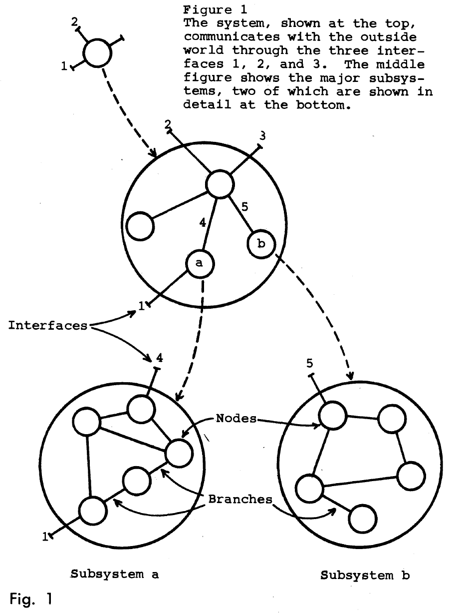

## 서지 정보

- 제목: How Do Committees Invent?
- 저자: Melvin E. Conway
- 기관: Sperry Rand Corporation, UNIVAC Division
- 발표 / 출판: Datamation
- 출판 연도: 1968
- 링크 / 코드·데이터:
	- 논문: https://www.melconway.com/Home/pdf/committees.pdf

---

## 세 줄 요약

- 시스템을 설계하기 위해서는 설계 방향을 가진 설계 조직이 필요하다.
- 그런데 시스템은 그 시스템을 설계한 조직의 의사소통 구조를 닮으므로, 잘못된 조직 구조에서는 잘못된 시스템이 탄생한다.
- 시스템을 잘 설계하기 위해서는 의사소통 구조를 단순하게 유지하고 조직 구성이 잘못되었다 싶으면 기민하게 조정할 수 있어야 한다.

---

## 요약

### 시스템 설계 조직

- '시스템 설계'는 다양한 부분들을 일관된 구조로 통합하여 전체를 만들어내는 지적 활동이다. 시스템 설계는 대개 의뢰인을 염두에 두고 행해진다. 의뢰인은 설계된 시스템을 통하여 어떤 활동을 수행하고자 한다. e.g., 재난의 이유를 분석하고 재발 방지 대책 세우기, 신규 제품 개발을 위한 계획 수립.
- 시스템 설계는 기본적으로 다음의 단계를 거친다.
	1. 제약 조건 파악 및 설계 원칙 수립. e.g., 예산, 기간, 인력, 목표 성능
	2. 초기 방향 설정: 대략적인 설계 방향 잡기 + 설계 팀들 구성.
	3. 완성: 여러 팀의 설계가 서로 호환되도록 조정하여 통합.
- 그런데 초기 방향 설정 단계에서 팀 구성이 끝났다는 것은 이미 꽤 많은 것이 정해져 버렸다는 것을 의미한다. *(작성자 주. 예를 들어서, 설계 조직을 디자인팀 / 제작팀으로 나누었다면 디자인과 제작이 어느 정도 독립적이리라 가정한 것이다.)* 결국 초기 방향 설정은 시스템 설계에 있어 편향으로 작용한다.
- 하지만 설계 방향과 설계 팀들 없이는 시스템 설계가 불가능하다. 결론적으로 시스템 설계에서 편향은 불가피하다.

### 설계된 시스템

- 시스템이 설계되었다는 것은 더 작은 하위 시스템들이 구성되었다는 것을 의미한다. 하위 시스템들은 상위 시스템 만큼이나 그 자체로 하나의 온전한 시스템이며, 하위 시스템을 더 작은 하위 시스템을 쪼갤 수 있다.
- 예를 들어, 대중 교통 시스템은 버스, 기차, 비행기 등의 교통 수단과 주차장, 터미널, 항만 등의 인프라 시스템으로 나눌 수 있다. 한 단계 더 내려가면, 비행기는 구조, 추진, 전력, 통신, 운반 시스템으로 나눌 수 있다.
- 우리는 시스템을 노드, 시스템 간 소통 가능 여부를 엣지로 삼아 전체 시스템을 선형 그래프로 표현할 수 있다. 최근에는 이런 엣지를 '인터페이스'라고 부르는 경우가 많으니 우리도 이 용어를 사용하자. (맨 위 세 줄 요약의 Fig 1 참고)

### 시스템 설계 조직과 시스템의 관계

- 우리는 시스템을 그래프로 추상화했다. 비슷하게 시스템 설계 조직도 다음과 같이 그래프로 표현할 수 있다. 노드는 위원회, 하위 노드는 하위 위원회, 엣지는 조정자.
- 이 논문의 요지는 시스템 그래프가 그 시스템을 설계한 조직의 그래프와 유사하다는 것이다. 다시 말해, 시스템은 그 시스템을 설계한 조직의 의사소통 구조를 닮게 된다.
- 두 구조가 닮게 되는 이유는 다음과 같다.
	- 노드의 관점: 모든 하위 시스템에는 그것을 설계한 그룹이 존재하므로 두 그래프의 노드를 대응시킬 수 있음. 하나의 팀이 여러 하위 시스템을 만드는 경우가 있어서 일대일 대응은 안 되겠지만 여전히 대강의 구조는 보존됨.
	- 엣지의 관점: 기능적으로 연결된 두 하위 시스템의 담당 조직은 반드시 인터페이스를 협의해야 함. 즉, 시스템 그래프에서 연결되어 있다면 조직 그래프에서도 연결.

### 편향으로서의 조직 구성

- 어떤 제약 조건을 만족하는 설계는 다양할 수 있다. 조직은 다양한 설계 중에 가장 최적의 설계를 선택하는 것이 아니라 자신의 의사소통 구조와 가장 닮은 설계로 수렴한다. 설계자들의 입장에서는 자기 팀과 소통해서 하위 시스템을 만드는 것은 쉬운 반면에 다른 팀과 협업하는 것은 어렵기 때문.
- 예를 들어, 대부분의 경우 하드웨어 엔지니어와 소프트웨어 엔지니어는 서로를 용인하는 수준에 그칠 뿐 효과적으로 협업하지는 못한다. 둘 사이의 효과적인 협업은 조직 구성이 받쳐줄 때에만 드물게 일어난다.

### 시스템 붕괴와 관리

- 지금까지의 논의의 연장선에서 시스템 붕괴를 분석해 보자. 여기서 시스템 붕괴란 하위 시스템들이 통합되지 못하고 파편화되는 상황을 의미한다.
- 시스템 붕괴는 다음의 과정을 거쳐 발생한다.
	1. **과도한 설계:** 설계 작업에 지나치게 많은 인력 투입.
	2. **조직 붕괴:** 대규모 설계 조직에 전통적인 관리 원칙 적용하여 의사소통 구조 붕괴.
	3. **시스템 붕괴:** 조직의 의사소통 구조 붕괴가 시스템에 그대로 반영.
- 더 자세히 살펴보면 아래와 같다.
	1. **과도한 설계:** 책임자가 충분한 시간을 들여 전반적인 상황을 이해하고 설계 조직을 간명하게 구성하는 것이 이상적. 그러나 이러다가 실패할 시 책임자는 자원도 제대로 활용 못하고 시간만 오래 걸렸다는 비난을 받게 될까 두려움. 그래서 초기에 최대한의 자원을 투입하는 것에 집중할 뿐 (즉, 가용한 모든 사람들에게 많은 설계 문서를 요구할 뿐) 효율적 조직 구성은 등한시하게 됨. 또한, 책임자는 조직 구성 권한이 주어졌을 때 자신의 영향력을 확장하려는 동기에서 효율성은 무시한 채 최대한 큰 조직을 구성하려고 함. 문제는 책임자의 불건전한 동기로라도 조직이 한 번 구성되면 이로 인한 비효율성이 시스템에 필연적으로 반영된다는 것임.
	2. **조직 붕괴:** 과도하게 설계된 조직에서는 의사소통이 실패하기 쉬움. 이 실패를 부추기는 주요 요인은 '투입 인원 x 투입 기간'으로 인력을 계산하는 전통적인 관리 방식이다. 이 관리 방식은 '5명 x 40일'과 '100명 x 2일'이 같다고 본다. 지금까지 논의에서 알 수 있듯이 5명과 100명은 서로 다른 조직 형태를 가질 것이고, 당연히 서로 다른 시스템을 만들게 되는데, 전통적인 관리 방식은 이 사실을 무시한다. 종종 이를 해결하기 위해 피라미드 구조를 택하기도 하는데 (모든 하위 조직을 비슷한 수의 사람들로 만들기 위해) 오히려 의사소통이 더 어려워질 뿐임.
	3. **시스템 붕괴:** 상황이 여기까지 악화되었으면 시스템이 붕괴하는 것은 당연지사.

### 결론

- 조직 구성은 시스템 설계에 반영된다.
- 조직 구성이 필요 이상으로 복잡하면 시스템도 필요 이상으로 복잡해진다.
- 조직 구성이 시스템을 설계에 악영향을 준다면 조직 구성을 바꿔야 한다.
- 따라서 조직 구성 책임자가 1) 간결하고, 2) 유연하게 조직을 관리하도록 유도해야 한다.

---

## 읽고 든 생각

- 조직 생활 경험이 있는 누구나 공감할 부분이 많을 것 같다. 1960년대나 지금이나 비슷했다는 생각...
- 조직 구조를 유연하게 유지하는 것이 AI 에이전트로 인해 가능해지지 않을까? 조직에 사람 대비 AI가 많을수록 조직이 유연하다고 볼 수도 있을 것 같다. AI를 재배치하는 것은 사람보다 쉬우니까.
- 아무튼 여기 저기 허술한 부분이 있고 글도 잘 못 쓴 것 같지만 번뜩이는 통찰력 때문에 즐겁게 읽었다.

---

## 배운 점

- Conway의 이 논문은 사회 구조와 기술 구조의 합치 (Socio-Technical Congruence) 라는 연구 분야를 만들게 된다.

---

## 다음 읽을 것

- **콘웨이 법칙의 실증적 검증:** [The Mirroring Hypothesis](mirroring-hypothesis.ko.md)
- **AI 도입으로 인한 조직 구성 변경:** [The Cybernetic Teammate](cybernetic-teammate.ko.md)
- **Socio-Technical Congruence를 인간–에이전트 조직으로의 확장:** [Adapting Socio-Technical Congruence to Human-Agent Collectives](adapting-socio-technical-congruence.ko.md)

---

#software #organization #communication

