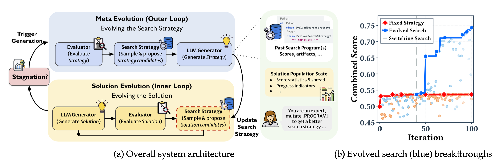

## Bibliographic Information

- title: EvoX: Meta-Evolution for Automated Discovery
- authors: Shu Liu, Shubham Agarwal, Monishwaran Maheswaran, Mert Cemri, Zhifei Li, Qiuyang Mang, Ashwin Naren, Ethan Boneh, Audrey Cheng, Melissa Z. Pan, Alexander Du, Kurt Keutzer, Alvin Cheung, Alexandros G. Dimakis, Koushik Sen, Matei Zaharia, Ion Stoica
- institutions: UC Berkeley, Stanford University, Bespoke Labs
- venue / publisher: arXiv
- publication year: 2026
- link / code & data:
  - paper: https://arxiv.org/abs/2602.23413
  - code: https://github.com/skydiscover-ai/skydiscover

---

## TL;DR

- Let LLMs improve not just solutions but the search process itself. For example, let the LLM write the code that selects which existing solutions to mutate!

---

## Summary

### Introduction

- LLMs play a major role in evolutionary optimization. *(Author's note. To put it simply, evolutionary optimization, or evolutionary search, repeatedly mutates previous solutions to find new ones and gradually improve the score. LLMs are often used for mutation these days because they are good at modifying solutions that do not fit a fixed format—for example, by writing new code...)*
- But what LLMs evolve is still limited to the solutions themselves. This paper argues that LLMs should be able to update the optimization strategy too. For example, instead of just improving code, an LLM should also be able to decide which code to draw on when making those improvements.
- Put simply, instead of looking for the optimal solution, the idea is to look for a search strategy that produces it. Once we find that strategy, we can run it to obtain the optimal solution. In other words, the search strategy becomes the object of optimization, rather than the solution itself.
- The authors call this meta-evolution method "EvoX."

### How to Find the Optimal Search Strategy

1. Assume we have a search strategy to start with. It defines rules for the following:
   - Which previous solutions to select as the material for mutation.
   - What kind of mutation to apply: small refinements, a fundamental redesign, or simply letting the LLM decide.
2. Run LLM-based mutation and evaluation under the current search strategy. The number of iterations in the paper is one tenth of the total budget: 10 iterations if the overall budget is 100.
3. If the score has improved enough after those iterations, keep going. Otherwise, ask the LLM to revise the search strategy. It proposes a new strategy based on previous strategies, the solutions they were applied to, and the resulting scores.
   - Here is a closer look at the LLM's inputs and outputs in this step.
   - Input
     - The problem description and an explanation of the evaluation method.
     - The budget already spent and the number of iterations the new strategy will get.
     - A small helper LLM's summary of statistics about the current solutions: the total number of solutions, score distribution, top 20 scores, number of distinct scores, iterations without improvement, and so on.
     - A small helper LLM's summary of the search strategies generated so far and how each performed.
   - Output
     - A Python class named `EvolvedProgramDatabase`.
     - Its two core methods determine which code to select as a reference and how generated solutions are stored.
     - The output is checked. If it does not run or has other problems, the LLM is asked to fix it.

### Results

- Experimental setup
  - Applied to a range of benchmarks in mathematics, systems design, algorithms, and other areas.
  - Compared against competing methods such as OpenEvolve and ShinkaEvolve.
  - Models used: GPT-5 and Gemini-3.0-Pro. Search strategies were generated with GPT-5.
  - A budget of 100 solution proposals.
- EvoX did find new search strategies—for example, exploring solutions that had rarely been used. Given the gradual improvement in these strategies, the LLM was not simply getting the right answer in one shot because it already knew it. In other words, the EvoX approach enabled the LLM to find better search strategies.
- Scores were better than those of competing methods in almost every case.

---

## Reflections

- The problem is clearly identified, which makes the argument easy to follow. I liked the idea of optimizing the process that produces solutions, rather than the solutions themselves.
- But looking through the code for optimizing that process left me a little puzzled. For something described as leaving process optimization to the LLM, the way it is fed information—how all the information accumulated so far is summarized—feels fairly static.
  - There is also so much information, and the selection feels rather arbitrary, that testing which pieces actually improve performance through ablation studies looks difficult too.

---

## Takeaways

- Research that gives LLMs more autonomy just to see what they do seems to be getting a lot of attention. Should we call it LLM expansionism...?

---

## Next reading

- None

---

#AI #LLM #optimization #evolutionary_search
