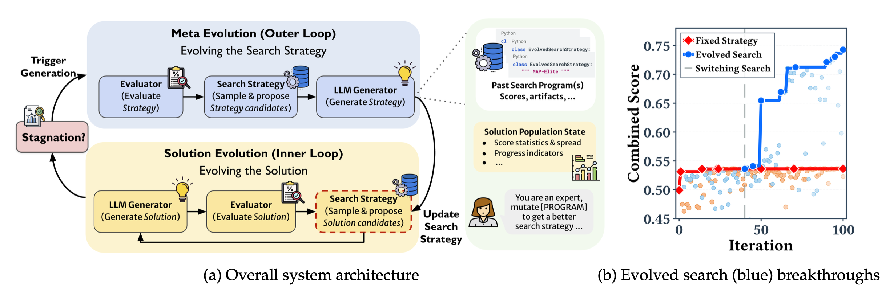

## 서지 정보

- 제목: EvoX: Meta-Evolution for Automated Discovery
- 저자: Shu Liu, Shubham Agarwal, Monishwaran Maheswaran, Mert Cemri, Zhifei Li, Qiuyang Mang, Ashwin Naren, Ethan Boneh, Audrey Cheng, Melissa Z. Pan, Alexander Du, Kurt Keutzer, Alvin Cheung, Alexandros G. Dimakis, Koushik Sen, Matei Zaharia, Ion Stoica
- 기관: UC Berkeley, Stanford University, Bespoke Labs
- 발표 / 출판: arXiv
- 출판 연도: 2026
- 링크 / 코드·데이터:
	- 논문: https://arxiv.org/abs/2602.23413
	- 코드: https://github.com/skydiscover-ai/skydiscover

---

## 세 줄 요약

- 진화적 탐색 최적화에서 LLM이 해법 뿐 아니라 탐색 방식도 개선하게 하자. e.g., 변이를 가할 기존 해법을 가져오는 코드를 LLM이 알아서 짜게 하자!

---

## 요약

### 서론
- 진화적 최적화에서 LLM은 큰 역할을 하고 있다. *(작성자 주. 간단하게 이야기하자면 이렇다. 진화적 최적화, 혹은 진화적 탐색은 이전 해법에 돌연변이를 일으켜서 새로운 해법을 찾아내는 과정을 반복하여 점점 점수를 올려나가는 방법이다. 최근 돌연변이 연산에 LLM을 쓰곤 한다. 왜냐하면 LLM이 비정형 해법을 변이시키는 능력이 좋기 때문이다. 예컨대 새로운 코드를 작성하게 한다든지...)*
- 그런데 LLM이 진화시키는 대상은 해법에 그치고 있다. 이 논문은 LLM이 해법 뿐 아니라 최적화 전략까지도 업데이트할 수 있어야 한다고 주장한다. 예를 들어, LLM이 코드만 개선하지 말고 코드 개선을 위해 어떤 코드를 참고할 것인지도 알아서 선택할 수 있어야 한다.
- 쉽게 말하면, 최적의 해법을 찾는 대신에 최적의 해법을 만들어내는 탐색 전략을 찾겠다는 것이다. 그 탐색 전략을 찾아서 그대로 실행하면 최적의 해법을 구할 수 있게 되니까. 다시 말해, 최적화의 대상이 해법이 아니라 탐색 전략인 셈이다.
- 저자들은 이러한 메타 진화 방법론을 'EvoX'라고 이름 붙였다.

### 최적의 탐색 전략 찾는 법
1. 현재 주어진 탐색 전략이 있다고 가정한다. 탐색 전략은 규칙 기반으로 다음을 정의한다.
	- 이전의 해법 중에 어떤 것들을 골라서 변이의 재료로 삼을지.
	- 고른 해법에 어떤 변이를 가할지. e.g., 세부 개선, 근본적 재설계, 혹은 아무렇게나 알아서
2. 주어진 탐색 전략에 따라 LLM 변이와 이에 대한 평가를 반복한다. 논문의 반복 횟수는 전체 예산의 1/10. 만약 총 100번의 루프를 돌기로 했다면 10회 반복.
3. 정해진만큼 루프를 돌았는데 점수가 잘 올랐으면 계속 진행. 반면에 안 올랐으면 LLM에게 탐색 전략 수정을 요청한다. LLM은 과거의 탐색 전략, 그 전략이 적용된 해답들, 해당하는 점수들을 보고 새로운 전략을 제안한다.
	- 이 단계에서 LLM의 Input/Output을 더 자세하게 보면 이렇다.
	- Input
		- 문제 설명 + 평가 방식 설명
		- 현재 소진한 예산 + 새로운 탐색 전략에게 몇 번의 루프를 돌 기회가 있는지
		- 현재 해법들의 통계치들을 (e.g., 전체 해법 수, 점수 분포, 상위 20개의 점수들, 서로 다른 점수 개수, 개선 없이 지나간 루프 수, 기타 등등) 작은 보조 LLM이 요약한 글
		- 현재까지 생성했던 탐색 전략들과 각 전략의 실행 성과를 작은 보조 LLM이 요약한 글
	- Output
		- `EvolvedProgramDatabase`라는 파이썬 클래스를 산출
		- 핵심 메소드는 1) 참고할 코드를 어떻게 고를지, 2) 생성한 해법을 어떤 기준에 따라 저장할지
		- 이 산출물은 유효성 검사를 거친다. 만약에 안 돌거나 문제가 있으면 LLM에게 수정을 요구한다.

### 결과
- 실험 조건
	- 수학, 시스템 설계, 알고리즘 등 다양한 벤치마크에 적용.
	- 다양한 경쟁 방법론과 비교. e.g., OpenEvolve, ShinkaEvolve.
	- 사용한 모델은 GPT-5, Gemini-3.0-Pro. 탐색 전략 생성에는 GPT-5 사용.
	- 총 100개의 해법 제안 가능하도록 예산 설정.
- EvoX는 실제로 새로운 탐색 전략을 찾아냈다. 예를 들어, 잘 사용되지 않은 해법들을 탐색해 본다든지. EvoX가 찾은 탐색 전략이 점진적으로 개선되는 점으로 미루어 볼 때, LLM이 미리 정답을 알고 한 번에 맞춘 것이 아니다. 즉, EvoX 방식이 있었기에 LLM이 더 좋은 탐색 전략을 찾을 수 있었다.
- 점수도 거의 대부분의 경우 경쟁 방법론들보다 좋았다.

---

## 읽고 든 생각

- 문제 인식이 명확해서 논리 전개가 아주 깔끔하다고 생각. 해법이 아니라 해법을 만들어내는 절차를 최적화하자...는 말이 좋았음.
- 그런데 그 절차 최적화의 코드를 뜯어보면 조금 엥? 싶긴 했음. 왜냐하면 절차 최적화를 LLM에게 자율적으로 맡겼다기에는 LLM에게 제공하는 정보가 (i.e., 지금까지 쌓인 모든 정보를 어떻게 요약해서 줄 것인지) 정적으로 정해져 있는 느낌.
	- 또, 제공된 정보들이 너무나 많고 임의적이라 어떤 정보를 제공해야 성능이 좋아지는지 ablation도 좀 어려워 보임.

---

## 배운 점

- LLM에게 더 많은 자율성을 주어서 어떻게 하는지 보자는 연구들이 각광 받는 것 같다. LLM의 확장주의적 행보...라고 해야 할까?

---

## 다음 읽을 것

- None

---

#AI #LLM #optimization #evolutionary_search
