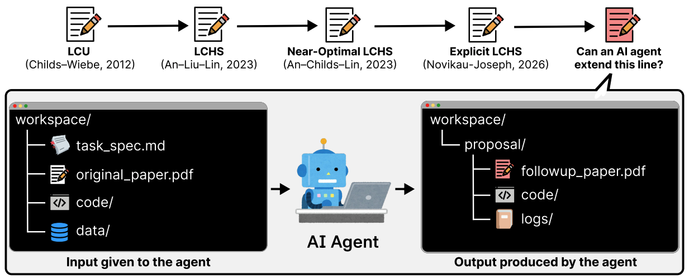

## Bibliographic Information

- title: Into the Unknown: Benchmarking AI agents on open scientific research problems
- authors: Seungone Kim, Jiayi Geng, Young-Jun Lee, Bo Liu, Juyoung Suk, Nicholas Lubbers, Mitchell Wood, Marcus Noack, Yong-Xin Yao, Yuan Shi, Roxana Bujack, Cristina Garcia Cardona, Austin Rodriguez, Ilon Joseph, Woojin Cho, Zora Zhiruo Wang, Chuanyang Jin, Ian Wu, Apurva Gandhi, Tianjian Li, Weiwei Sun, Carolin Lawrence, Kiril Gashteovski, Dongyeop Kang, Jay Shin, Akari Asai, Graham Neubig, Sean Welleck
- institutions: Carnegie Mellon University, University of Minnesota, Stanford University, Trillion Labs, Los Alamos National Laboratory, Sandia National Laboratory, Lawrence Berkeley National Laboratory, Ames National Laboratory, Iowa State University, University of Colorado Boulder, Michigan State University, Lawrence Livermore National Laboratory, TelePIX, Johns Hopkins University, NEC Laboratories Europe, Ss.Cyril and Methodius University of Skopje
- venue / publisher: arXiv
- publication year: 2026
- link / code & data:
  - paper: https://arxiv.org/abs/2610.19159v1
  - GitHub: https://github.com/prometheus-eval/into-the-unknown
  - Hugging Face: https://huggingface.co/datasets/prometheus-eval/into-the-unknown
  - leaderboard: https://prometheus-eval.github.io/into-the-unknown/viewer/

---

## TL;DR

- Give an AI a paper, the data, and the code, and ask it to write a better follow-up. Human experts still provide hints about where to take the research, of course!
- Even frontier agents struck out: not a single submission met the success criteria.

---

## Summary

### Introduction

- AI agents can now work on tasks that take days, and they are starting to show results on complex scientific problems.
- So how capable are today's AI research agents? Can they go beyond assisting researchers and carry out scientific research from start to finish?
- This paper introduces ***INTO THE UNKNOWN***, a benchmark designed to answer that question. It gives AI agents information and asks them to produce research outputs.
- The authors tested nine frontier models using their default harnesses. Each agent was asked to write 15 papers. Producing all 135 papers took 1,942.81 hours in total.
- Here is what came out of those 135 submissions:
  - Consistent across the paper, data, and code: 21.
  - Complete enough across the paper, code, and logs to count as finished research: 1.
  - Met the success criteria set by the researchers: 0.

### Experimental Setup

- **The 15 papers to build on**
  - Mostly provided by researchers at the U.S. Department of Energy.
  - Roughly half were published some time ago; the rest are recent or unpublished.
  - Further research must be possible with just the code and data—for example, in computational science.
- **Agent inputs and outputs**
  - Inputs: an existing paper, its code and data, and a task specification covering the research direction, experimental conditions, success criteria, search space, and computing resource constraints. Internet access is allowed too.
  - Required outputs: a new paper, experimental code, and execution logs.
- **Models used**
  - Claude-Opus-4.8, Claude-Opus-5, Claude-Fable-5, Claude-Opus-5.5, GPT-5.6-Sol, GPT-6-Astra, DeepSeek-V4-Pro-0813, Kimi-K3, GLM-5.3.
- **How the agents worked**
  - Each used its default harness. Models without one used software-agent-sdk.
  - The agents worked without human intervention or a time limit, within the task specifications and allocated computing resources.
  - The Ralph Wiggum loop relaunched each agent in the same workspace for up to five rounds, stopping once it judged its submission complete.
- **How the research outputs were evaluated**
  - Measurable rubrics: AI converted the researchers' freely written research directions and success criteria into measurable items. The researchers reviewed and finalized them.
  - Evaluation agent: GPT-6-Astra + codex-sdk + max reasoning effort + max context length... Each submission was evaluated four times. Paper-level grading used a majority vote on each rubric item: at least three passes out of four, with a 2–2 tie counted as a failure.

### Results

- As mentioned above, out of 135 submissions:
  - Consistent across the paper, data, and code: 21.
  - Complete enough across the paper, code, and logs to count as finished research: 1.
  - Met the success criteria set by the researchers: 0.
- Three models produced submissions with no contradictions between the paper, data, and code: GPT-6-Astra (11), GPT-5.6-Sol (6), and Claude-Opus-5.5 (4). The other six struck out.
- The only submission complete enough to count as finished research came from GPT-6-Astra. It still fell short of the scientist's success criteria.

### Why Couldn't They Get It Right?

1. Overly generous self-evaluation: in most trajectories, agents declared success and moved on even though they had not actually succeeded.
2. Not enough self-correction: in about half the trajectories, agents recognized earlier mistakes but carried on without fixing them.
3. Moving the goalposts: in roughly a third of the trajectories, agents changed the goal on their own.

- With these problems, spending longer on reasoning did not necessarily lead to better results.

---

## Reflections

- It seems the harness needs to compensate for these three weaknesses.
  - People keep pointing out that agents lack these abilities. Are these problems persisting despite efforts to address them through harness design? If so, why? That seems like a useful direction to investigate.
- Requiring the output to take the form of a research paper might be a little too human-centered...
- It is great that the authors released the reasoning trajectories on Hugging Face!

---

## Takeaways

- For now, distinguishing what AI can and cannot do still matters.

---

## Next reading

- None

---

#AI #LLM #agent #benchmark #evaluation #science
