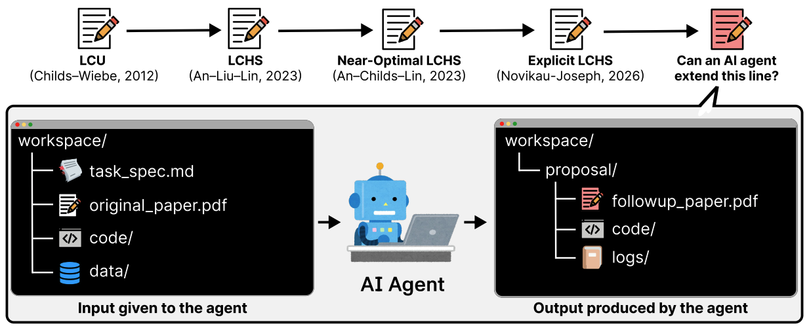

## 서지 정보

- 제목: Into the Unknown: Benchmarking AI agents on open scientific research problems
- 저자: Seungone Kim, Jiayi Geng, Young-Jun Lee, Bo Liu, Juyoung Suk, Nicholas Lubbers, Mitchell Wood, Marcus Noack, Yong-Xin Yao, Yuan Shi, Roxana Bujack, Cristina Garcia Cardona, Austin Rodriguez, Ilon Joseph, Woojin Cho, Zora Zhiruo Wang, Chuanyang Jin, Ian Wu, Apurva Gandhi, Tianjian Li, Weiwei Sun, Carolin Lawrence, Kiril Gashteovski, Dongyeop Kang, Jay Shin, Akari Asai, Graham Neubig, Sean Welleck
- 기관: Carnegie Mellon University, University of Minnesota, Stanford University, Trillion Labs, Los Alamos National Laboratory, Sandia National Laboratory, Lawrence Berkeley National Laboratory, Ames National Laboratory, Iowa State University, University of Colorado Boulder, Michigan State University, Lawrence Livermore National Laboratory, TelePIX, Johns Hopkins University, NEC Laboratories Europe, Ss.Cyril and Methodius University of Skopje
- 발표 / 출판: arXiv
- 출판 연도: 2026
- 링크 / 코드·데이터:
	- 논문: https://arxiv.org/abs/2610.19159v1
	- github: https://github.com/prometheus-eval/into-the-unknown
	- huggingface: https://huggingface.co/datasets/prometheus-eval/into-the-unknown
	- leaderboard: https://prometheus-eval.github.io/into-the-unknown/viewer/

---

## 세 줄 요약

- AI에게 논문, 데이터, 코드를 주고 개선된 논문을 쓰게 시켜 보자. 물론 발전 방향에 대한 힌트는 인간 전문가가 준다!
- 프론티어 에이전트들도 제대로 된 결과를 하나도 못 내고 전멸.

---

## 요약

### 서론

- AI 에이전트가 며칠씩 걸리는 긴 작업을 수행할 수 있게 되면서 복잡한 과학 문제에서도 성과를 보이고 있다.
- 그렇다면 현재 'AI 연구 에이전트'의 수준은 어느 정도일까? 단순 보조를 넘어 과학 연구를 처음부터 끝까지 수행할 수 있을까?
- 이 논문은 이 질문에 답변하기 위한 벤치마크 ***INTO THE UNKNOWN***을 소개한다. 이 벤치마크는 AI 에이전트에게 정보를 제공하고 연구 산출물을 요구한다.
- 9개의 프론티어 모델을 기본 하네스 구현으로 실험했다. 각 에이전트에게 15개의 논문을 작성하라고 요구했다. 총 135편의 논문을 작성하는 데에 1942.81 시간이 걸렸다.
- 결론은 이렇다. 135편 중에...
	- 논문, 데이터, 코드 사이에 모순이 없는 경우: 21편
	- 논문, 코드, 로그가 완전해서 연구가 완성되었다고 볼 수 있는 경우: 1편
	- 연구자가 설정한 성공 기준을 통과한 경우: 0편

### 실험 조건

- 발전시킬 15편의 논문
	- 주로 미국 에너지부 연구자들이 제공.
	- 절반은 예전에 발표된 논문, 나머지 절반은 최근에 발표되었거나 미발표 논문.
	- 코드와 데이터만 있으면 추가적인 연구가 가능한 연구들. e.g., 계산과학 분야
- 에이전트의 Input/Output
	- 에이전트에게 제공 되는 정보: 발전시키고자 하는 기존 논문, 기존 논문의 코드와 데이터, 작업 명세 (연구 방향, 실험 조건, 성공 조건, 탐색 공간, 컴퓨팅 자원 제약) + 인터넷 검색 허용
	- 요구되는 연구 산출물: 새로운 논문, 실험 코드, 실행 로그
- 사용된 AI 목록
	- Claude-Opus-4.8, Claude-Opus-5, Claude-Fable-5, Claude-Opus-5.5, GPT-5.6-Sol, GPT-6-Astra, DeepSeek-V4-Pro-0813, Kimi-K3, GLM-5.3
- 에이전트 동작 방식
	- 각각 기본 하네스. 기본 하네스 없는 경우 software-agent-sdk 사용.
	- 작업 명세의 조건과 할당된 컴퓨팅 자원 안에서 인간의 개입 없이 수행. 별도의 시간 제한은 없음.
	- 같은 작업 공간에서 에이전트를 최대 5회까지 다시 실행하는 Ralph Wiggum 루프 사용. 산출물이 완성되었다고 에이전트 스스로 판단하면 재실행 종료.
- 연구 산출물 평가 방식
	- measurable rubrics: 연구자가 자유롭게 적은 연구 방향과 성공 조건을 AI가 측정 가능한 항목으로 변환. 연구자가 그 항목들을 검수 후 최종 결정.
	- 평가 에이전트: GPT-6-Astra + codex-sdk + max reasoning effort + max context length... 각 산출물을 네 번 평가. 논문별 통과 판정에는 항목별 다수결을 사용 (4회 중 3회 이상 통과, 2:2는 실패).

### 결과

- 위에서 이야기했듯이, 135편 중에...
	- 논문, 데이터, 코드 사이에 모순이 없는 경우: 21편
	- 논문, 코드, 로그가 완전해서 연구가 완성되었다고 볼 수 있는 경우: 1편
	- 연구자가 설정한 성공 기준을 통과한 경우: 0편
- 그나마 GPT-6-Astra 11편, GPT-5.6-Sol 6편, Claude-Opus-5.5 4편은 논문, 데이터, 코드 사이에 모순이 없었고 나머지는 전멸.
- 연구가 완성되었다고 볼 수 있는 경우는 GPT-6-Astra가 제출한 단 한 편. 다만 이 글도 연구자의 성공 기준은 통과하지 못했다.

### 왜 똑바로 못했는지?

1. 관대한 자기 평가: 대부분의 추론 궤적에서 안 됐는데 됐다고 하고 그냥 넘어감.
2. 부족한 자기 수정: 절반 정도의 추론 궤적에서 과거의 실수를 알았음에도 수정하지 않고 넘어감.
3. 목표 재설정: 3분의 1 정도의 추론 궤적에서 자기 마음대로 목표를 바꿈.

- 상황이 이러니까 추론 시간이 길어진다고 해서 결과가 더 좋지는 않음.

---

## 읽고 든 생각

- 세 가지 결점을 하네스로 교정해줘야 할 것 같다.
	- 사실 에이전트에게 이런 능력이 부족하다는 사실은 계속 지적되고 있는데, 아무리 하네스를 씌워도 이 문제가 해결되지 않는 것인지? 그렇다면 이유가 무엇인지? 이런 쪽으로 접근하면 좋을 듯.
- 결과물을 논문 형식의 글로 적는다...는 게 너무 인간중심적인 요구 사항일 수도 있다는 생각.
- 저자들이 huggingface에 추론 궤적을 공개한 것은 참 멋지다!

---

## 배운 점

- AI가 잘하는 것과 못하는 것의 구분이 아직까지는 중요하다.

---

## 다음 읽을 것

- None

---

#AI #LLM #agent #benchmark #evaluation #science
