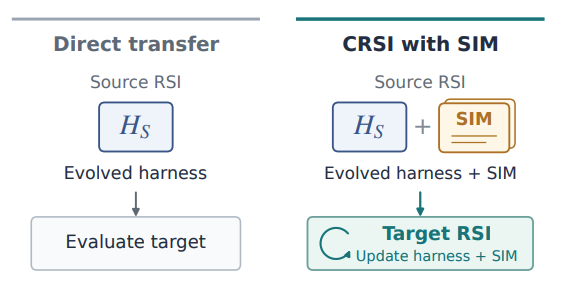

## Bibliographic Information

- title: Self-Improvement Memory Enables Continual Recursive Self-Improvement
- authors: Xin Yu, Fei Xia, Jiaqi Pan, Youbao Tang, Chengzhi Liu, Adams Yu, Sicong Jiang, Yanfei Chen, Lingzhou Xue, Ting Yu
- institution: Google Cloud AI, Google DeepMind, Google Cloud AI Research, The Pennsylvania State University
- venue / publisher: arXiv
- publication year: 2026
- link / code & data:
  - paper: https://arxiv.org/abs/2611.18856
  - PDF: https://arxiv.org/pdf/2611.18856

---

## TL;DR

- When we run a harness improvement loop, let's also update a JSON file that keeps track of the changes. It records what changed and how, in plain language.
- The authors call this record of past improvements Self-Improvement Memory (SIM).
- SIM can help with self-improvement itself, with picking up a run where it left off, or even with continuing the work on a different model or in a different environment.

---

## Summary

### Introduction

- An agent's performance depends on both the model and its harness. A growing body of research shows that changing the harness alone can improve performance while keeping the model weights fixed.
- Previous work on Recursive Self-Improvement (RSI) has mostly focused on improving the harness over repeated rounds with a fixed model and task.
- To keep improving after a model update or a change in the kinds of tasks, we need to build on what we learned from earlier rounds.
- The problem is that a change that worked in the old setting might not work in the new one. We have to decide which changes to keep, revise, or remove.
- The harness code itself tells us little about what earlier changes were meant to fix, why they were made, what they were expected to do, or how they actually performed.
- The authors call this setting Continual Recursive Self-Improvement (CRSI). They propose Self-Improvement Memory (SIM) as a way to record and reuse what the optimizer learns along the way.

### Method

#### The Harness Improvement Loop

1. Run the tasks with the current harness. The evaluator returns scores, execution logs, and errors.
2. The proposer uses the current code, evaluation results, past edits, and SIM to come up with candidate changes. Before evaluation, it records the cause of failure each change targets and which tasks it expects to improve.
3. The selector screens candidates before they run. Once the remaining candidates have been evaluated, it chooses one based on performance, code complexity, dependencies, the risk of making previously working tasks worse, and so on.
4. Use the selected harness in the next round and add the selected change's expected and actual results to SIM. If no change is accepted, keep the current harness and SIM and run another round.

#### What SIM Stores

- Keep the improvement history in a single JSON file, organized by cause of failure.
  - What changed and why.
  - What the change was expected to do and how it actually performed.
  - The model, benchmark, round, and other details of the experiment.
- Record accepted changes, including cases where they fall short of the expected effect.
- The proposer and selector receive the full SIM every round, without summarization or retrieval.

### Experiments

- Common setup
  - Four domains: coding, text classification, document work, and engineering design.
  - Change the model or benchmark, then continue improving the harness.
  - Run 10 rounds per environment and propose five candidate changes per round.
- Four conditions
  - **Cold Start** starts over with the initial harness.
  - **Harness Transfer** carries over the improved harness.
  - **Problem-Only Memory** carries over the harness and the causes of past failures.
  - **Full SIM** carries over the harness and the full SIM, which is updated as the run continues.

### Results

- Full SIM had the highest final score in all six benchmark transfer settings and all four model transfer settings. So the memory seems to help with self-improvement itself.
  - In the repeated coding experiment, SIM did better in nine of ten runs.
- When the harness was passed from one model generation to the next, it did better than starting fresh in two of three transfers. So SIM can help with transfer learning too.
- Keeping just the causes of failures sometimes made performance worse. That suggests the rest of the record matters.

### Conclusion

- Keeping and reusing what the optimizer learns during self-improvement can help it continue improving after the environment changes.
- The paper did not compare SIM directly with other ways of managing memory, so it is hard to tell whether its particular structure is better.

---

## Reflections

- Plenty of earlier work already records and reuses the history of improvements. The idea feels only modestly new.
- I would be more interested in how a plain edit history compares with a structured record like SIM. Even there, I get the sense that other papers have looked at the question more closely.
- I liked the idea of borrowing from transfer learning and making use of what the AI and ML community already knows. It seems like a good direction, though the paper feels a step behind other work, and I wish the method and the analysis of the results had been more thorough.

---

## Takeaways

- Memory matters. We can organize harness edits by the problems they address instead of just listing them in chronological order.
- Transfer learning can work for harness optimization too.

---

## Next reading

- None

---

#AI #LLM #agent #memory #optimization #harness
