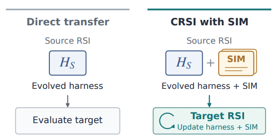

## 서지 정보

- 제목: Self-Improvement Memory Enables Continual Recursive Self-Improvement
- 저자: Xin Yu, Fei Xia, Jiaqi Pan, Youbao Tang, Chengzhi Liu, Adams Yu, Sicong Jiang, Yanfei Chen, Lingzhou Xue, Ting Yu
- 기관: Google Cloud AI, Google DeepMind, Google Cloud AI Research, The Pennsylvania State University
- 발표 / 출판: arXiv
- 출판 연도: 2026
- 링크 / 코드·데이터:
	- 논문: https://arxiv.org/abs/2611.18856

---

## 세 줄 요약

- 하네스 개선 루프를 돌릴 때 개선 이력이 담긴 메모리도 json 파일로 같이 업데이트 치자. (뭘 어떻게 고쳤는지 자연어로 적혀 있음)
- 이 개선 경험을 Self-Improvement Memory(SIM)라고 부른다.
- SIM은 자가 개선 자체에 도움이 될 뿐 아니라, 학습을 중간부터 이어가고 싶을 때, 혹은 심지어 다른 모델이나 다른 환경에서 이어서 학습하고 싶을 때에도 도움이 된다.

---

## 요약

### Introduction

- 에이전트의 성능은 모델뿐 아니라 하네스에도 달려 있다. 모델 가중치를 바꾸지 않고 하네스만 고쳐도 성능을 올릴 수 있다는 연구들이 많이 제안되고 있다.
- 기존의 Recursive Self-Improvement(RSI) 연구는 주로 모델과 과제를 고정한 상태에서 하네스를 반복적으로 개선하는 데 집중.
- 그러나 지속적인 자가 개선을 위해서는 모델이 업데이트되거나 과제의 성격이 바뀌더라도 이전의 개선 경험을 바탕으로 최적화를 이어갈 수 있어야 한다.
- 문제는 기존 환경에서 유효했던 수정이 새로운 환경에서도 유효하다는 보장이 없다는 것. 어떤 수정은 유지하고, 어떤 수정은 변경하거나 제거해야 하는지 판단해야 함.
- 하네스 코드 자체에는 이전 수정의 목적, 근거, 기대 효과, 실제 평가 결과 등 개선 과정에서 얻은 경험이 충분히 담겨 있지 않다.
- 저자들은 환경이 변화하더라도 하네스의 개선을 이어가는 연구 설정을 Continual Recursive Self-Improvement(CRSI)로 정의하고, 이를 위해 개선 경험을 명시적으로 축적하고 활용하는 Self-Improvement Memory(SIM)를 제안한다.

### Method

#### 하네스 개선 루프

1. 현재 하네스로 과제를 실행한다. 평가기는 점수, 실행 기록, 오류를 돌려준다.
2. 제안자(proposer)가 현재 코드와 평가 결과, 이전 수정 이력, SIM을 보고 후보 수정안을 만든다. 어떤 실패 원인을 고치려는지와 어떤 과제가 좋아질 것으로 예상하는지도 평가 전에 기록.
3. 선택자(selector)가 실행 전에 후보를 걸러낸다. 검사를 통과한 후보들을 실제로 평가한 뒤, 성능, 코드 복잡도, 의존성, 기존 성능을 해칠 가능성 등등을 감안하여 하나를 고른다.
4. 채택된 하네스로 다음 라운드를 진행하고, 선택된 수정의 예상과 실제 결과를 SIM에 추가한다. 채택한 수정이 없으면 하네스와 SIM을 유지하여 한 번 더 루프 돌림.

#### SIM에 저장하는 정보

- 실패 원인별로 개선 이력을 하나의 JSON 파일에 누적.
    - 수정 내용 및 이유.
    - 예상 효과 및 실제 평가 결과.
    - 모델, 벤치마크, 라운드 등 실험 조건.
- 채택된 수정안 혹은 예상한 효과를 얻지 못한 경우에는 기록.
- 매 라운드 제안자와 선택자에게 SIM 전문을 제공. 요약이나 검색 없음.

### Experiments

- 공통 조건
	- 코딩, 텍스트 분류, 문서 업무, 공학 설계의 4개 도메인에서 실험.
	- 모델 또는 벤치마크를 변경한 뒤 하네스 개선을 이어서 진행.
	- 환경별 10라운드, 라운드당 5개 수정 후보 제안.
- 비교할 네 가지 실험 조건
    - **Cold Start:** 초기 하네스부터 다시 개선.
    - **Harness Transfer:** 개선된 하네스만 계승.
    - **Problem-Only Memory:** 하네스와 실패 원인만 계승.
    - **Full SIM:** 하네스와 전체 SIM을 계승하고 지속적으로 갱신.

### Results

- 6개의 벤치마크와 4개의 모델 모든 조건에서 Full SIM의 성능이 가장 높았음. 즉, SIM은 자가개선 자체에 도움이 됨.
	- 특히, 코딩 분야에서 10회 중 9회 성능 향상.
- 모델이 계속 변경되는 실험에서는 3번 중 2번 성능 향상. 즉, SIM은 전이학습에서도 도움이 됨.
- 실패 원인만 제공하는 것은 오히려 성능을 떨어뜨리는 경우도 있었음. 즉, SIM의 설계가 타당해서 여기서 뭘 빠뜨리면 성능 안 나옴.

### Conclusion
- 자가개선 과정에서 얻은 경험을 축적하고 활용하는 것이 환경 변화 이후에도 개선을 이어가는 데 도움이 됨.

---

## 읽고 든 생각

- 개선 이력을 축적하고 활용하는 아이디어는 기존 연구에도 다수 존재. 참신성은 제한적인 것으로 보임.
- 일반적인 수정 이력을 제공하는 것과 SIM처럼 구조화된 이력을 제공하는 것 사이에 어떤 성능 차이가 있는지가 오히려 더 흥미로운 연구 질문이긴 한데, 이 질문에 대해서도 이미 다른 연구들이 더 꼼꼼하게 해 놓은 것 같긴 함.
- 전이학습을 흉내내겠다...는 발상이 기존에 AI/ML 커뮤니티가 쌓아온 지식을 십분 활용하려고 하는 것으로 보여서 효과적으로 느껴졌음. 하지만 뭔가 남들에 비해 한 발 늦은 느낌이고 방법론과 실험 결과 분석이 철저하지 않아 보임 ㅠ

---

## 배운 점

- 메모리가 중요하다: 하네스 개선 이력을 단순히 시간순으로 기록하는 대신 실패 원인별로 관리할 수 있음.
- 하네스 최적화에서도 전이학습을 할 수 있다

---

## 다음 읽을 것

- None

---

#AI #LLM #agent #memory #optimization #harness
