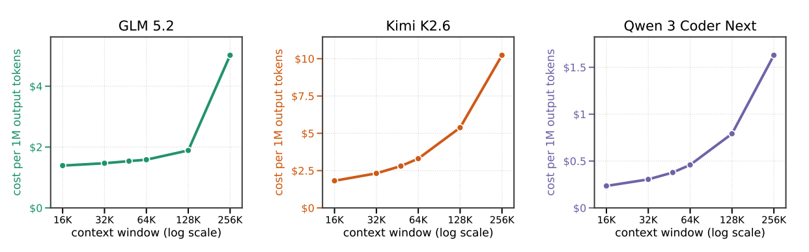

## Bibliographic Information

- title: You don't need long context
- authors: Peter Belcak, Saurav Muralidharan, Jindong Jiang, Yonggan Fu, Wonmin Byeon, Hanrong Ye, Ryan Angilly, Ali Taghibakhshi, Shih-Yang Liu, Siru Ouyang, Greg Heinrich, Pavlo Molchanov
- institution: NVIDIA
- venue / publisher: arXiv
- publication year: 2026
- link / code & data:
  - paper: https://arxiv.org/abs/2611.05306
  - lab: https://nv-dler.github.io/

---

## TL;DR

- Model architectures have evolved to handle very long contexts, so developers often keep long conversation histories too.
- But is keeping all that history really necessary? Could shorter model inputs save inference costs and even help performance?
- For tasks that require multiple actions, the authors kept the conversation history short. For tasks with very long inputs, they let the model read only the parts it needed. Performance did not improve, but it stayed close to what the models achieved with the full history.

---

## Summary

### Introduction

- Longer contexts make token generation slower and use more memory. If performance stays roughly the same, keeping the context short would be preferable.
- So the research question is whether shortening the context changes performance.

### Keeping Context Short

- **Long-horizon tasks:** For tasks that involve a sequence of actions, compare three ways of managing memory.
  - Accumulate the entire conversation.
  - Once the context reaches a certain length, ask the model to summarize its progress and next steps, then start a new conversation with the original task and that summary.
  - Maintain only a summary, with no original conversation history. After each tool call, update the summary with information from the tool's inputs and outputs and pass it to the next turn. It is a bit like a handoff note, with pointers to where things can be found.
- **Tasks with long inputs:** Provide the source material as files. Tell the model where to find them and let it use Bash to read the parts it needs.
  - Use `grep` to find occurrences of names or numbers, then `sed` to read the surrounding text.
  - Limit each read to 6,000 characters.
- If a task both requires multiple actions and has a long input, combine the two strategies. For example, provide the source material as files and accumulate the full conversation history.

### Experimental Setup

- Models compared
  - Closed-weight models: Claude Opus 4.5 and GPT 5.6 Sol. These are the two main models used for comparison.
  - Open-weight models: Qwen 3.6 27B, Qwen 3 Coder Next, Gemma 4 31B, Step 3.7 Flash, and MiniMax M2.7.
- Harnesses: mini-swe-agent for coding tasks and mini-agent for the rest. Both use a basic ReAct loop: run Bash, read the result, and choose the next action.
- Tasks were split into two groups, using the following benchmarks.
  - Tasks requiring multiple actions: SWE-bench Verified and Multilingual, Terminal-Bench 2.1, FRAMES, τ²-bench, and BFCLv3.
  - Tasks with long source material: LongBench v2, LOONG, AA-LCR, NIAH, RULER, Counting-Stars, and BABILong.
- For periodic summarization, the context limit was reduced to 48K, 32K, 24K, and 16K tokens for comparison. At a 16K limit, summarization starts around 12K, leaving the remaining space to generate the summary.

### Results

- **Long-horizon tasks:** Periodic summarization broadly preserved performance on the two main models.
  - Qwen 3 Coder Next, however, saw its SWE-bench accuracy drop from 53.0% to 3.6% compared with keeping the full conversation history.
  - Other models could keep working from summaries alone, though they still missed some things. The performance drop was not large.
- **Tasks with long inputs:** Reading only the relevant parts preserved or improved accuracy on almost every benchmark.
  - On RULER in particular, accuracy rose from 62.5% to 95.7% for Opus and from 65.5% to 96.4% for GPT. The summarization count was zero for both, so the main benefit here came from finding and reading only the relevant parts.

### Costs and a Proposal for Model Training

- Summarization can reduce inference costs for short inputs and outputs. With long inputs and outputs, though, it can make inference more expensive: summaries add newly generated tokens, and fewer input tokens can be reused from the cache. Even so, it looks worth trying.
- **Semantic State Space Model (SSSM):** The authors go further and propose training models around the sequence "read the summary → decide what to do → act → update the summary."
  - In other words, an LLM takes the full history as input and outputs the next token. An SSSM takes the current state and a handoff note as input, then outputs the next state and an updated note.

---

## Reflections

- I think this is a worthwhile paper, for a few reasons.
  - It may seem obvious that compressing a long context well can reduce inference costs with little loss in performance. Still, there is value in actually testing and showing it.
  - The compression strategy is simple, which makes it practical to apply.
  - Focusing on inference costs feels timely.
- What I found less satisfying:
  - There was still some performance loss.
  - During compression, the context can become less similar to the previous one, which may actually increase caching costs. That is a bit disappointing.

---

## Takeaways

- Dumping all the data on an agent gives it a lot of autonomy, but it is inefficient. To keep that autonomy while improving efficiency, try giving it files and letting it decide what to read.

---

## Next reading

- None

---

#AI #LLM #agent #memory #optimization #harness
