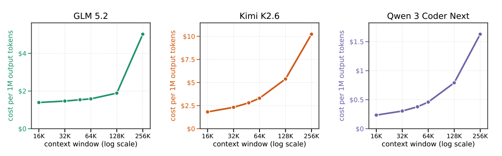

## 서지 정보

- 제목: You don't need long context
- 저자: Peter Belcak, Saurav Muralidharan, Jindong Jiang, Yonggan Fu, Wonmin Byeon, Hanrong Ye, Ryan Angilly, Ali Taghibakhshi, Shih-Yang Liu, Siru Ouyang, Greg Heinrich, Pavlo Molchanov
- 기관: NVIDIA
- 발표 / 출판: arXiv
- 출판 연도: 2026
- 링크 / 코드·데이터:
	- 논문: https://arxiv.org/abs/2611.05306
	- PDF: https://arxiv.org/pdf/2611.05306
	- 연구실: https://nv-dler.github.io/

---

## 세 줄 요약

- 모델 아키텍쳐는 아주 긴 컨텍스트를 받을 수 있도록 발전해왔기 때문에 개발자들도 종종 대화 이력을 길게 유지하곤 한다.
- 그런데 과연 대화 이력을 길게 유지하는 것이 필수적일까? 오히려 모델 input을 짧게 유지하는 것이 추론 비용도 아끼고 성능에도 도움이 되지 않을까?
- 여러 개의 행동이 필요한 긴 과제에서는 대화 이력을 짧게 유지하고, 그냥 애초에 인풋 자체가 엄청 긴 과제에서는 필요한 부분만 찾아 읽게 해 보았다. 성능이 올라가지는 않았지만 전체 이력을 보존할 때랑 큰 차이가 없었다.

---

## 요약

### 서론

- 컨텍스트가 길어지면 토큰 생성이 느려지고 메모리 사용도 늘어난다. 그래서 성능에 큰 차이가 없다면 컨텍스트를 짧게 유지하는 것이 좋을 것이다.
- 그래서 컨텍스트를 짧게 유지할 때 성능 차이가 나는지 실험해 보자는 것이 이 논문의 연구 질문이다.

### 컨텍스트를 줄이는 법

- **long horizon tasks:** 여러 행동을 연쇄적으로 하는 작업의 경우에는 세 가지 메모리 관리 방식을 비교해 보자.
	- 모든 대화를 누적.
	- 일정 길이마다 모델에게 진행 상황과 다음 할 일 등을 정리하게 하고, 원래 과제와 함께 새 대화로 넘김.
	- 대화 이력의 원문 없이 요약본만 관리. 도구를 한 번 쓸 때마다 도구의 입출력 결과를 요약본에다가 적어서 다음 턴으로 넘김. 약간 인수인계 메모 느낌으로 어디를 보면 뭐가 있다... 이런 정보를 적음.
- **long context tasks:** 입력 자료 자체가 긴 경우에는 원문을 파일로 제공한다. 모델에게는 파일 위치를 알려 주고 bash로 필요한 부분을 찾아 읽게 한다.
	- `grep`으로 이름이나 숫자가 나오는 곳을 찾고 `sed`로 앞뒤 문맥을 읽는 식.
	- 한 번에 읽는 양은 6000로 제한.
- 만약에 여러 행동이 필요한데 입력 자료 자체도 긴 경우에는 두 전략을 혼합해서 사용. e.g., 원문을 파일로 주고 모든 대화를 누적

### 실험 조건

- 비교 모델
	- 폐쇄 모델: Claude Opus 4.5, GPT 5.6 Sol (이 두 개가 주요 비교 모델임)
	- 오픈 모델: Qwen 3.6 27B, Qwen 3 Coder Next, Gemma 4 31B, Step 3.7 Flash, MiniMax M2.7
- 하네스: 코딩 과제에서는 mini-swe-agent, 나머지에는 mini-agent. 둘 다 bash를 실행하고 결과를 받아 다음 행동을 고르는 기초적인 ReAct 구조.
- 과제는 두 종류로 나누어서 실험. 아래는 사용한 벤치마크.
	- 여러 번의 행동이 필요한 과제: SWE-bench Verified·Multilingual, Terminal-Bench 2.1, FRAMES, τ²-bench, BFCLv3.
	- 처음 주어지는 자료가 긴 과제: LongBench v2, LOONG, AA-LCR, NIAH, RULER, Counting-Stars, BABILong.
- 일정 길이마다 요약하는 실험에서는 주로 컨텍스트 상한을 48K·32K·24K·16K 토큰으로 줄여가며 비교. 16K 상한이면 12K쯤에서 요약을 시작하고 나머지 공간은 요약 생성에 사용.

### 결과

- long horizon: 두 주요 모델에서 일정 길이마다 요약해도 성능은 대체로 유지.
	- 그러나 Qwen 3 Coder Next 모델의 경우 SWE-Bench에서 정답률이 53.0% -> 3.6%로 급감 (전체 대화 이력 보존 대비).
	- 다른 모델들은 요약만으로 작업을 이어갈 수 있었으나 아무래도 놓치는 부분이 생기긴 함. 물론 성능이 크게 떨어지지는 않음.
- long context: 필요한 부분만 읽게 해도 거의 모든 벤치마크에서 정확도가 유지되거나 개선.
	- 특히 RULER 벤치마크에서는 정답률이 Opus가 62.5% -> 95.7%, GPT가 65.5% -> 96.4%. 이때 요약 횟수는 둘 다 0이라서 요약이 아니라 필요한 부분만 찾아 읽는 것이 큰 역할.

### 비용과 모델 학습에 대한 제안

- 요약 전략을 활용하면 짧은 입출력의 추론 비용을 줄일 수 있다. 하지만 긴 입출력의 경우 오히려 추론 비용이 늘어날 수 있다. 요약하면서 새로 생성하는 토큰이 늘고, 캐시로 재사용하는 입력은 줄어들 수 있기 때문. 그럼에도 사용해 봄직한 전략임.
- Semantic State Space Model (SSSM): 저자들은 더 나아가 '요약본 읽기 - 행동 결정 - 행동 수행 - 요약본 갱신'의 절차를 중심으로 모델을 학습시키자고 제안.
	- 다시 말해, LLM은 전체 이력을 입력으로 받아서 다음을 토큰을 출력하는 반면에 SSSM은 상태값과 인수인계 메모를 입력으로 받아서 다음 상태값과 메모를 출력.

---

## 읽고 든 생각

- 의미 있는 논문이라고 생각함. 왜냐하면
	- 긴 맥락을 잘 압축하면 성능 저하가 거의 없이 추론 비용을 아낄 수 있다는 것이 상식일 수도 있으나 '직접 실험해서' 보여줬다는 것은 의미 있어 보임.
	- 압축 전략이 간단해서 적용 가능성 높음.
	- 추론 비용 절감을 화두로 잡은 것이 시의적절함.
- 반면 아쉬운 점은
	- 성능 저하가 없지는 않았음.
	- 압축 과정에서 오히려 캐싱 비용이 늘어날 수도 있다는 점은 (이전의 컨텍스트를 그대로 쓰지 않으므로) 아쉽긴 함.

---

## 배운 점

- 에이전트에게 모든 데이터를 때려 박는 것은 자율성은 높지만 효율성이 낮다. 자율성을 높게 유지하면서 효율성까지 높이려면 파일을 주고 알아서 읽으라고 해 보자.

---

## 다음 읽을 것

- None

---

#AI #LLM #agent #memory #optimization
